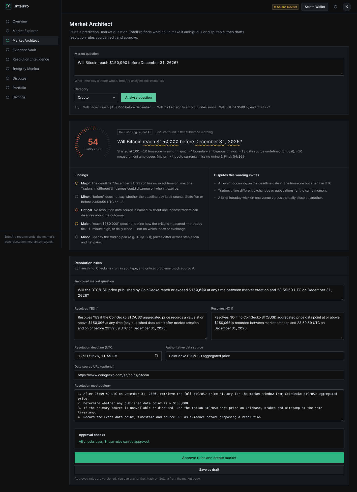

# Lockline

**Most market disputes start with one vague word.**

Lockline finds it before launch, locks the fixed rules on Solana, and opens the market on the PREDICT pm-AMM. Traders bet on rules that can't move.

Live: https://intelpro.vercel.app

**The flow:** Write → Lock → Trade → Resolve.
1. **Write.** Type a question. The checker flags vague deadlines, missing data sources and subjective words, and drafts exact YES/NO conditions.
2. **Lock.** The approved rules are hashed (SHA-256) and written to Solana with an SPL Memo before the market opens.
3. **Trade.** The market launches on the PREDICT pm-AMM, linked to that hash.
4. **Resolve.** The outcome is checked against the locked rules and stored evidence, and can be challenged in the open.

*(Formerly IntelPro; code identifiers still use that name.)*



## What it does

| Module | What you get |
|---|---|
| **Market Architect** | Finds ambiguous wording, unclear deadlines, missing data sources and subjective language in a question, underlines the exact phrases, scores clarity 0–100 and drafts YES/NO rules you edit and approve. Rules are versioned and re-validated on the server before approval. |
| **Evidence Vault** | Per-market evidence from a **URL or an uploaded PDF** (≤10 MB, magic-byte checked; text layer extracted with pdfjs; scanned PDFs are reported unreadable, never summarised). URLs are fetched behind an SSRF guard. Content is compared with the approved rules. Status is one of: submitted, accessible, analysed, corroborated, contradicted, unable to verify. |
| **Resolution Intelligence** | YES supported / NO supported / inconclusive / insufficient evidence, with reasoning, uncertainty and missing information. Every citation must be a stored evidence record; anything else is discarded and unsupported conclusions are downgraded. Advisory only. |
| **Disputes** | Challenge a recommendation or a proposed outcome. Reviewers start review, request evidence, comment and decide. Every step is in the audit trail. Self-review is blocked. |
| **Integrity Monitor** | Healthy / needs attention / high risk / under dispute, from eleven named rules over stored data. No AI labels. |
| **Market Explorer** | IntelPro markets with filters, plus live PREDICT pm-AMM markets read from Solana (prices, vault liquidity, end time, state). |
| **Solana** | Wallet linking by signed message (ed25519, verified server-side). Approved rules can be anchored on-chain as a SHA-256 in an SPL Memo transaction. Every transaction is verified against the cluster before it is shown as successful. |
| **PREDICT pm-AMM** | Live discovery; launch an approved market; fund it through a commitment vault; **buy and sell YES/NO** with balances, slippage and on-chain-simulated quotes; resolve as market authority. Units, reserve encoding, winning side and sell math are verified against the SDK and program source. See [docs/PREDICT.md](docs/PREDICT.md). |
| **Accounts** | Email + password; **email verification** (unverified accounts can browse but not act); **password reset** (30-minute single-use links; all sessions signed out). Tokens are stored as HMACs. |

## Quick start

Requirements: Node 20.11+, PostgreSQL 14+.

```bash
cp .env.example .env            # set DATABASE_URL and SESSION_SECRET (openssl rand -hex 32)
npm install
npm run db:migrate              # applies prisma/migrations
npm run db:seed                 # admin account + labelled demonstration markets
npm run dev                     # http://localhost:3000
```

Sign in with `SEED_ADMIN_EMAIL` / `SEED_ADMIN_PASSWORD` from `.env`, or create an account (new accounts are market creators). In development, emails (verification and reset links) are printed to the server console (`EMAIL_TRANSPORT=log`).

**AI is optional.** Set `ANTHROPIC_API_KEY` to enable LLM analysis. Without it, IntelPro uses its deterministic rules engine and labels every result “Heuristic engine, not AI”.

## Scripts

| Command | Purpose |
|---|---|
| `npm run dev` / `build` / `start` | Next.js development, production build, production server |
| `npm test` | 62 unit and integration tests (Node test runner via tsx) |
| `npm run test:e2e` | Playwright browser tests against a production build (see [docs/TESTING.md](docs/TESTING.md)) |
| `npm run test:e2e:devnet` | Real devnet launch → buy → sell through the UI |
| `npm run test:db` | Migrations + constraint checks on a throwaway database |
| `npm run typecheck` / `npm run lint` | TypeScript / ESLint |
| `npm run verify` | typecheck + lint + unit tests + build |
| `npm run db:migrate` | Apply migrations (`prisma migrate deploy`) |
| `npm run db:seed` | Seed admin + demo data (idempotent) |

## Documentation

- [Demo script (3 minutes)](docs/DEMO.md)
- [API reference](docs/API.md)
- [PREDICT integration](docs/PREDICT.md)
- [Deployment](docs/DEPLOYMENT.md) (Docker or Vercel)
- [Testing](docs/TESTING.md)
- [Technical report: what's implemented, tested, live, and incomplete](docs/TECHNICAL_REPORT.md)

## Architecture

```
src/
  app/                 Next.js App Router pages + REST API (app/api/**/route.ts)
  components/          UI primitives (ui/), domain components, charts, wallet, PREDICT panels
  lib/
    ai/                Market Architect, evidence analysis, resolution engine, schemas, traceability guards
    evidence/          SSRF-safe fetcher, text extraction, status rules
    integrity/         Integrity rule engine (pure)
    solana/            base58, wallet proof, memo anchoring, transaction verification
    predict/           pm-AMM SDK services: server discovery + browser trading
    services/          Data access used by pages and routes
    auth/ server/      Sessions, RBAC, route wrapper, rate limits, audit log
prisma/                Schema, migration, seed
tests/                 62 automated tests + SQL constraint checks + fixtures (PDFs, vendored SDK math)
e2e/                   Playwright specs + Wallet Standard test wallet
```

Security notes: scrypt password hashing, HMAC-hashed session and email tokens in httpOnly cookies, Origin checks on mutations, role-based permissions on every mutating route, Zod validation on all input, SSRF protection with DNS pinning, rate limits, security headers, and an append-only audit log. IntelPro never stores private keys, never asks for seed phrases, and no AI output can move funds.
